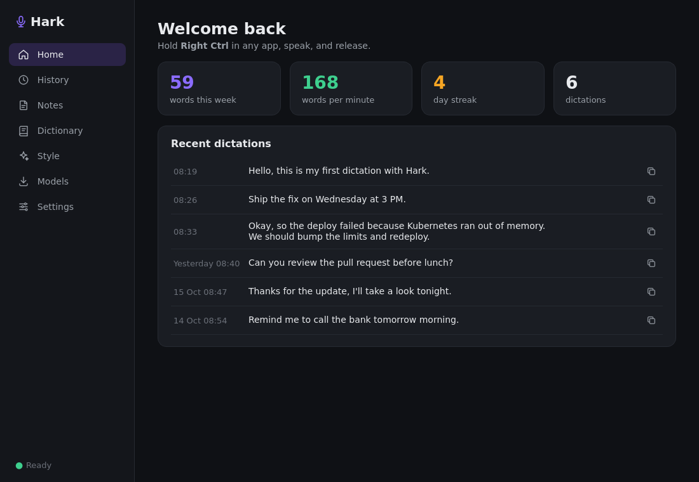
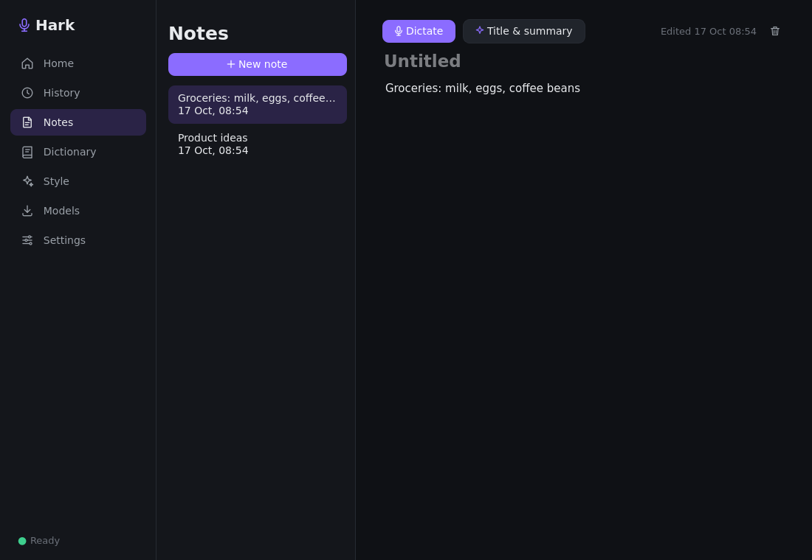
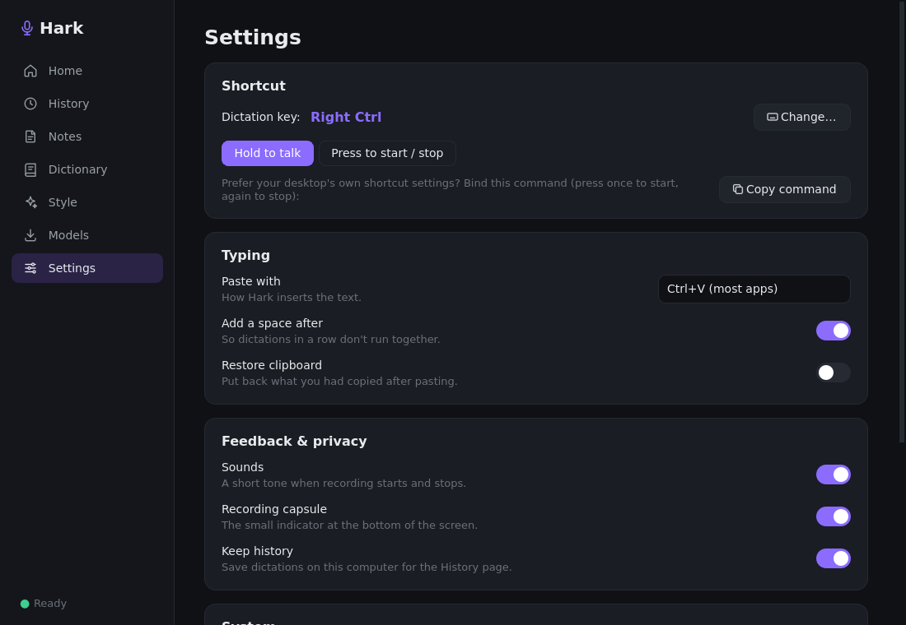

# Hark

Local-first push-to-talk dictation for Linux. Hold a key (or trigger `hark toggle`
from your desktop's shortcut settings), speak, and the text is typed into the focused
app. Speech-to-text runs on-device (Parakeet / Whisper), with optional cleanup by a
local Ollama model. Works on X11 and Wayland.

> Status: early development. Dictation, the desktop app and voice notes work; packaging
> (.deb/AppImage) and first-run onboarding come next.



## Install

```bash
# 1. System packages + keyboard/uinput permissions + Python venv (asks for sudo)
bash scripts/setup-linux.sh          # add --dry-run to preview every command

# 2. Log out and back in (so the 'input' group membership applies)

# 3. Check everything is ready
.venv/bin/hark doctor

# 4. Optional: local LLM cleanup of transcripts
bash scripts/install-ollama.sh       # pulls qwen2.5:3b; --model qwen2.5:1.5b for speed
```

Supported package managers: apt, dnf, pacman, zypper. On other distros, install
PortAudio, wl-clipboard, xclip and xdotool yourself, then run
`bash scripts/setup-linux.sh --skip-packages`.

### Why the permissions?

- **`input` group** lets Hark see your hotkey being held and released on any desktop,
  including Wayland, where apps can't register global hotkeys themselves.
- **`/dev/uinput`** lets Hark press Ctrl+V through a virtual keyboard to paste the text.

## The app

```bash
.venv/bin/hark app
```

Opens the dashboard and starts dictation. Closing the window keeps Hark running in the
background (quit from the tray, or `hark quit`); running `hark app` again reopens it.

- **Home:** words this week, speaking speed, streak, and your recent dictations.
- **History:** search, copy and delete past dictations (`Show original` = before cleanup).
- **Notes:** dictate straight into Hark's own notepad; optional AI title & summary.
- **Dictionary:** names and jargon Hark should spell your way.
- **Style:** cleanup rules, AI cleanup with Ollama, and a box to try it out.
- **Models:** download, switch and delete speech models.
- **Settings:** shortcut (press the keys you want), hold vs. toggle, paste method, sounds,
  the recording capsule, history, start at login, app-menu entry, and a system check.

| Notes | Settings |
|---|---|
|  |  |

While you dictate, a small capsule at the bottom of the screen shows a live waveform:


## Dictate from a terminal

```bash
.venv/bin/hark listen
```

Hold **Right Ctrl**, speak, release: the text is pasted wherever your cursor is.
Esc cancels; pressing another key while holding Right Ctrl (e.g. Right Ctrl+C) is
treated as a normal shortcut and cancels silently.

```
hark listen --mode toggle            press once to start, again to stop
hark listen --key leftmeta+space     try another shortcut (names: hark debug-hotkey)
hark config set hotkey.combo KEY_F9  change it permanently
hark config set insert.paste_chord ctrl+shift+v   for terminals
```

Troubleshooting: `hark debug-mic --transcribe`, `hark debug-hotkey`, `hark debug-paste`.

### In the background

```
hark daemon --detach     start in the background (logs: ~/.local/state/hark/hark.log)
hark status              idle / recording / transcribing, model, hotkey, last dictation
hark toggle              start/stop dictating — bind it to a desktop keyboard shortcut
hark start | stop | cancel
hark reload              re-read settings (done automatically by hark config/llm/vocab/models)
hark quit                stop the background service
hark history [-n 20] [--raw] | history clear
```

`hark toggle` works without the `input` group: bind it in your desktop's keyboard
settings (e.g. GNOME Settings → Keyboard → Custom Shortcuts) and press it to start and
again to stop. History is stored privately in `~/.local/share/hark/history.jsonl`;
turn it off with `hark config set save_history false`.

## Commands so far

```
hark doctor [--json]            check this machine and print fixes
hark config path|show|edit      settings file (~/.config/hark/config.json)
hark config get llm.model
hark config set llm.model qwen2.5:1.5b

hark models list                list speech models (* = active)
hark models download parakeet-v3 [--use]
hark models use whisper-small   set the active model
hark models rm whisper-small    delete a downloaded model
hark transcribe audio.wav       transcribe a file (wav/mp3/ogg/m4a…) with the active model
hark transcribe audio.wav --model whisper-base.en --json
hark transcribe audio.wav --no-llm | --raw

hark clean "um so I I think comma we should go"   run the cleanup pipeline on text
hark vocab add "hark ai" "Hark.ai"                 replacement
hark vocab add Kubernetes                         spelling hint
hark vocab list | rm <phrase>
hark llm use qwen2.5:3b | on | off | status | list
hark llm style plain|email|message|notes
```

## Text cleanup

Every transcript goes through fast, offline rules:

- **Fillers and stutters:** "um", "uh", "I I think" and set-off "you know" are removed.
- **Voice commands:** "comma", "question mark", "full stop", "new line", "new paragraph",
  "add a colon", "scratch that", "sorry, remove that", "at the rate KV" → `@KV`.
  Everyday phrases are left alone ("the Oxford comma", "please remove that file").
- **Vocabulary:** your replacements and spellings.

Optionally a local **Ollama** model then fixes grammar and self-corrections
("Tuesday, no wait, Wednesday" → "Wednesday"). Its reply is checked before it's used:
a reply that adds or drops too much, answers a question, or introduces new words is
discarded and the rule-based text is kept. Small models on CPU take a few seconds and
occasionally drop a word, so this is off by default; `hark llm use qwen2.5:3b` turns it on.

## Speech models

Models are downloaded on request into `~/.local/share/hark/models` and run fully offline.

| ID | Size | Languages | Notes |
|---|---|---|---|
| `parakeet-v3` (default) | 670 MB | 25 European languages | fast on CPU |
| `parakeet-v2` | 661 MB | English | best English accuracy |
| `whisper-base.en` | 148 MB | English | smallest |
| `whisper-small` | 486 MB | 99 languages | multilingual |
| `whisper-large-v3-turbo` | 1.6 GB | 99 languages | most accurate; slow without a GPU |
